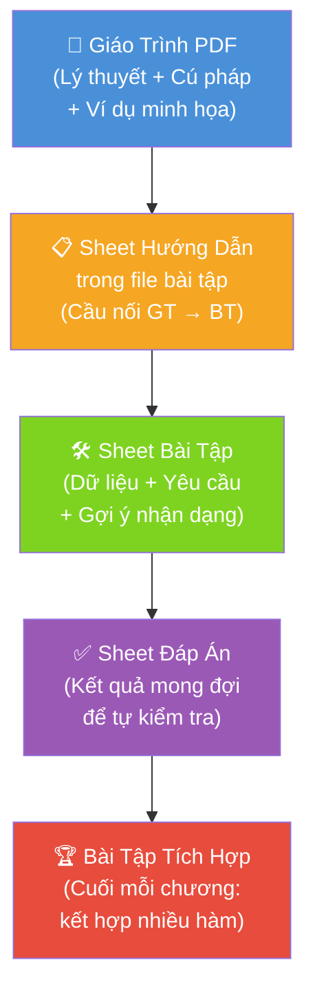

# 📊 Phân Tích Bài Tập & Đề Xuất Tổng Thể — Excel Nâng Cao 1

> [!NOTE]
> Tài liệu này phân tích 12 file bài tập `.xlsx` kết hợp với nội dung giáo trình để đưa ra đề xuất cải thiện toàn diện, giúp học viên tự học được và giáo viên giảm thời gian giảng lại.

---

## 🔎 PHẦN 1 — PHÂN TÍCH CHI TIẾT 12 BÀI TẬP HIỆN TẠI

### BÀI 01 — Hàm AND `(4 sheets: Bài 01→04)`
| Hạng mục | Nội dung |
|---|---|
| **Dữ liệu** | Bảng bán hàng: Mã SP, Tên SP, ĐVT, Nơi cung cấp, Số lượng |
| **Cấu trúc** | 3 bảng riêng biệt: Bảng 1 (kiểm tra SL), Bảng 2 (kiểm tra nơi cung cấp), Bảng 3 (kết hợp AND) |
| **Yêu cầu** | Câu 1: kiểm tra SL > 10 · Câu 2: kiểm tra nơi = Biên Hòa · Câu 3: dùng AND cho cả 2 |
| **Điểm tốt** | ✅ Phân tầng rõ: từ 1 điều kiện → nhiều điều kiện · Câu 4 yêu cầu tự đối chiếu kết quả |
| **Vấn đề** | ❌ Không có hướng dẫn gợi ý khi học viên sai · Chỉ 4 dòng dữ liệu — quá ít để học viên thấy ý nghĩa |

### BÀI 02 — Hàm OR `(4 sheets: Bài 01→04)`
| Hạng mục | Nội dung |
|---|---|
| **Dữ liệu** | Tương tự Bài 01 (sản phẩm, nơi cung cấp) |
| **Cấu trúc** | 3 bảng song song tương tự AND nhưng dùng OR |
| **Điểm tốt** | ✅ Cấu trúc nhất quán với Bài 01, dễ so sánh |
| **Vấn đề** | ❌ Không có bảng nào yêu cầu học viên **so sánh AND vs OR** trên cùng 1 dữ liệu — đây là điểm học viên hay nhầm nhất |

### BÀI 03 — Hàm IF + AND `(nhiều sheets)`
| Hạng mục | Nội dung |
|---|---|
| **Dữ liệu** | Bảng nhân viên: Mã NV, Họ tên, Bộ phận, Thâm niên, Chức vụ |
| **Yêu cầu** | Tính tiền thưởng dựa trên thâm niên VÀ chức vụ |
| **Điểm tốt** | ✅ Ngữ cảnh thực tế (thưởng nhân viên) phù hợp |
| **Vấn đề** | ❌ Không giải thích tại sao cần dùng AND trong IF · Học viên không biết viết từ đâu khi chưa hiểu logic |

### BÀI 04 — Hàm IF + OR `(nhiều sheets)`
| Hạng mục | Nội dung |
|---|---|
| **Dữ liệu** | Bảng sản phẩm, loại sản phẩm, giảm giá |
| **Yêu cầu** | Tính giảm giá nếu loại SP là "Gia dụng" hoặc "Điện tử" |
| **Vấn đề** | ❌ Cùng vấn đề: không có gợi ý xây dựng logic từng bước |

### BÀI 05 — Hàm COUNTIF `(1 sheet)`
| Hạng mục | Nội dung |
|---|---|
| **Dữ liệu** | Bảng chấm công tháng 4/2025 (8 nhân viên, 13 ngày): ký hiệu 1, 0.5, "x" |
| **Yêu cầu** | Câu 1: đếm ngày đủ công (=1) · Câu 2: đếm nửa ngày (=0.5) · Câu 3: đếm ngày trống · Câu 4: đếm ngày "x" |
| **Điểm tốt** | ✅ Dữ liệu thực tế, có đủ trường hợp cần kiểm tra · Ngữ cảnh công sở gần gũi |
| **Vấn đề** | ❌ **Không có gợi ý dạng điều kiện** cho từng câu (ví dụ: câu 3 "ngày trống" dùng `""` hay `COUNTBLANK`?) — đây là điểm học viên hay hỏi nhất |

### BÀI 06 — Hàm COUNTIFS `(1 sheet)`
| Hạng mục | Nội dung |
|---|---|
| **Dữ liệu** | Danh mục nhân viên: Mã NV, Họ tên, Giới tính, Phòng ban, Ngày nghỉ phép, Email, Tình trạng hôn nhân |
| **Yêu cầu** | 4 câu: đếm nữ có ngày phép · nữ có GĐ · nữ IT · nam Kế toán |
| **Điểm tốt** | ✅ Ngắn gọn, 4 câu tăng dần độ phức tạp |
| **Vấn đề** | ❌ Chỉ có **1 sheet** — không có phần hướng dẫn gợi ý như Bài 02 của SUMIF · Dữ liệu có ô trống (NV002, NV005, NV007 thiếu ngày phép và hôn nhân) nhưng không giải thích ý nghĩa → học viên nhầm lẫn |

### BÀI 07 — Hàm SUMIF `(4 sheets: Bài 01→04)`
| Hạng mục | Nội dung |
|---|---|
| **Sheet Bài 01** | Chỉ dùng lọc thủ công (không dùng hàm) — **bước chuẩn bị tư duy tuyệt vời** |
| **Sheet Bài 02** | Có "Hướng dẫn" 3 bước rõ ràng ngay trong file + công thức mẫu đã điền sẵn 1 ô |
| **Sheet Bài 03** | Yêu cầu tính tổng doanh thu (không có gợi ý) |
| **Sheet Bài 04** | Dữ liệu phức tạp hơn: theo ngày, nhiều cột |
| **Điểm tốt** | ✅ **Bài 07 là bài tập được thiết kế tốt nhất** — có cả phần không dùng hàm → so sánh → dùng hàm · Có hướng dẫn 3 bước inline |
| **Vấn đề** | ❌ Bài 03, 04 không có gợi ý → giảm đột ngột |

### BÀI 08 — Hàm SUMIFS `(3 sheets: Bài 01→03)`
| Hạng mục | Nội dung |
|---|---|
| **Sheet Bài 01** | Bảng bán hàng theo ngày + SP, yêu cầu hoàn thành báo cáo tổng hợp **không dùng hàm** |
| **Sheet Bài 02** | Có gợi ý 3 bước chi tiết + công thức mẫu dạng layout inline |
| **Sheet Bài 03** | Yêu cầu tính doanh thu (không có gợi ý) |
| **Điểm tốt** | ✅ Tiếp tục phong cách tốt của Bài 07 · Gợi ý rất cụ thể: "Cặp 1: Cột lọc 1: Ngày bán... ↔ Điều kiện lọc 1: Từ ngày >=H12" |
| **Vấn đề** | ❌ Chưa có phần giải thích **tại sao thứ tự tham số SUMIFS khác SUMIF** |

### BÀI 09 — Hàm SUMPRODUCT `(4 sheets: Bài 01→04)`
| Hạng mục | Nội dung |
|---|---|
| **Dữ liệu** | Bảng bán hàng ngày + SP + SL + đơn giá (phức tạp hơn) |
| **Sheet Bài 01** | Không dùng hàm → xác định tổng thủ công |
| **Sheets còn lại** | Dùng SUMPRODUCT với các điều kiện khác nhau |
| **Điểm tốt** | ✅ Dữ liệu có cả ngày, loại SP, số lượng → phù hợp để luyện SUMPRODUCT |
| **Vấn đề** | ❌ **Không có sheet nào giải thích cơ chế hoạt động của SUMPRODUCT** (mảng TRUE/FALSE nhân với số) → học viên dùng mà không hiểu tại sao · Không có bài yêu cầu dùng điều kiện OR trong SUMPRODUCT |

### BÀI 10 — Chuẩn hóa dữ liệu & Tư duy Table `(nhiều sheets)`
| Hạng mục | Nội dung |
|---|---|
| **Dữ liệu** | Có dữ liệu "bẩn" (merge cells, dòng trống, v.v.) và dữ liệu "sạch" |
| **Yêu cầu** | Thực hành chuẩn hóa và chuyển sang Table |
| **Vấn đề** | ❌ Không có checklist chuẩn hóa · Không giải thích **tại sao** từng lỗi làm hỏng PivotTable |

### BÀI 11 — Tạo và thiết lập PivotTable
| Hạng mục | Nội dung |
|---|---|
| **Dữ liệu** | Bảng bán hàng đã chuẩn hóa (đầy đủ cột: Ngày, Loại SP, Mã SP, Tên SP, ĐVT, SL, Đơn giá, Thành tiền) |
| **Vấn đề** | ❌ Không có hướng dẫn các bước tạo PivotTable ngay trong file · Học viên phải vừa nhìn giáo trình vừa thao tác → khó |

### BÀI 12 — Định dạng báo cáo PivotTable
| Hạng mục | Nội dung |
|---|---|
| **Vấn đề** | ❌ Không có file mẫu kết quả → học viên không biết báo cáo đúng trông như thế nào |

---

## 🩺 PHẦN 2 — CHẨN ĐOÁN VẤN ĐỀ GỐC RỄ

### Vì sao học viên không hiểu phải hỏi nhiều lần?

```
Giáo trình (PDF)          Bài tập (Excel)         Học viên
─────────────────         ───────────────          ─────────
Lý thuyết ngắn gọn   →   Nhảy thẳng vào làm   →  "Tôi không
(không giải thích          (không gợi ý)             biết bắt
tham số chi tiết)                                     đầu từ đâu"
```

**4 khoảng cách lớn** giữa giáo trình và bài tập:

| # | Khoảng cách | Biểu hiện cụ thể |
|---|---|---|
| 1 | **Thiếu cầu nối "đọc → làm"** | Giáo trình có cú pháp, bài tập chỉ có yêu cầu — không có bước trung gian |
| 2 | **Không có "điểm neo" nhận dạng bài toán** | Học viên không biết câu hỏi nào dùng COUNTIF, câu nào dùng COUNTIFS |
| 3 | **Độ khó tăng đột ngột** | Bài 07 (SUMIF) có gợi ý tốt → Bài 09 (SUMPRODUCT) gần như không có |
| 4 | **Không có phản hồi** | Học viên không biết kết quả mình làm đúng hay sai |

---

## 💡 PHẦN 3 — ĐỀ XUẤT CẢI THIỆN TOÀN DIỆN

### A. Thêm "Sheet Hướng Dẫn" Vào Mỗi File Bài Tập

> [!IMPORTANT]
> Đây là đề xuất **ưu tiên số 1**. Mỗi file bài tập nên có thêm 1 sheet đầu tiên là **"Hướng Dẫn"** với nội dung:

**Cấu trúc sheet Hướng Dẫn:**
```
┌─────────────────────────────────────────────────────┐
│  BÀI XX — TÊN HÀM                                  │
│  ─────────────────────────────────────────────────  │
│  📌 Cú pháp: =TÊN_HÀM(tham số 1, tham số 2, ...)   │
│  📌 Tham số 1: [giải thích ngắn]                    │
│  📌 Tham số 2: [giải thích ngắn]                    │
│  ─────────────────────────────────────────────────  │
│  ✅ Ví dụ mẫu (có công thức điền sẵn 1 ô)           │
│  ─────────────────────────────────────────────────  │
│  ⚠️  Lưu ý khi làm:                                 │
│  - Điều kiện so sánh phải để trong nháy kép ""      │
│  - [Lỗi thường gặp của bài này]                     │
│  ─────────────────────────────────────────────────  │
│  📋 Các câu cần hoàn thành: (liệt kê số sheet)      │
└─────────────────────────────────────────────────────┘
```

---

### B. Thêm "Khung Nhận Dạng Bài Toán" (Áp dụng cho Bài 05–09)

Trước mỗi câu hỏi, thêm 1 ô nhỏ gợi ý nhận dạng:

| Dạng câu hỏi | Hàm cần dùng | Gợi ý nhận dạng |
|---|---|---|
| "Đếm số ... thỏa mãn 1 điều kiện" | `COUNTIF` | Chỉ có 1 cột lọc |
| "Đếm số ... thỏa mãn nhiều điều kiện" | `COUNTIFS` | Có 2+ cột lọc |
| "Tính tổng ... theo 1 loại" | `SUMIF` | 1 cột lọc + 1 cột tổng |
| "Tính tổng ... theo nhiều điều kiện" | `SUMIFS` | 2+ cột lọc + 1 cột tổng |
| "Tính tổng tích / điều kiện OR phức tạp" | `SUMPRODUCT` | Cần nhân mảng |

---

### C. Thêm Sheet "Kết Quả Mẫu" (Ẩn hoặc Sheet riêng)

Hiện tại chỉ có Bài 07 (Sheet Bài 02) có 1 ô kết quả mẫu (Gạo thơm lài = 237). Tất cả các bài còn lại học viên không biết kết quả đúng để kiểm tra.

**Đề xuất:** Thêm cột "Kết quả mong đợi" ẩn, hoặc 1 sheet riêng "Đáp án" để học viên tự đối chiếu.

---

### D. Cải Thiện Từng Bài Tập Cụ Thể

#### Bài 01 & 02 (AND, OR) — Thêm Sheet So Sánh

Thêm 1 sheet cuối tên **"So sánh AND vs OR"** với cùng 1 bảng dữ liệu, 2 cột kết quả song song:

```
Mã SP | Nơi cung cấp | SL | AND(SL>10, NC=Biên Hòa) | OR(SL>10, NC=Biên Hòa)
SP01  | Hậu Giang    | 15 | FALSE                    | TRUE
SP02  | Biên Hòa     | 50 | TRUE                     | TRUE
SP03  | Phú Quốc     | 10 | FALSE                    | FALSE
SP04  | Biên Hòa     | 5  | FALSE                    | TRUE
```
→ Học viên **nhìn thấy ngay sự khác biệt** giữa AND và OR.

---

#### Bài 05 (COUNTIF) — Thêm Gợi Ý Dạng Điều Kiện

Câu hỏi "đếm ngày trống" là câu học viên hỏi nhiều nhất. Nên thêm bảng gợi ý:

```
Muốn đếm...          | Viết điều kiện thế nào
Ngày đủ công (=1)    | 1  hoặc  "=1"
Nửa ngày (=0.5)      | 0.5
Ngày nghỉ phép ("x") | "x"
Ngày trống (rỗng)    | ""   ← THƯỜNG BỊ NHẦM
```

---

#### Bài 06 (COUNTIFS) — Giải thích ô trống trong dữ liệu

Hiện tại NV002, NV005, NV007 có ô trống (không có ngày phép và tình trạng hôn nhân). Cần thêm ghi chú:

> *"Ô trống = nhân viên chưa có thông tin. Câu 1 yêu cầu đếm nhân viên Nữ ĐÃ có ngày phép → ô trống không được đếm."*

---

#### Bài 08 (SUMIFS) — Thêm Lưu Ý Thứ Tự Tham Số

Thêm vào Sheet Hướng Dẫn:

```
⚠️ CẢNH BÁO QUAN TRỌNG:
  SUMIF:   (vùng_điều_kiện, điều_kiện, vùng_tổng)   ← vùng tổng ở CUỐI
  SUMIFS:  (vùng_tổng, vùng_đk1, đk1, vùng_đk2, đk2) ← vùng tổng ở ĐẦU
  → ĐÂY LÀ ĐIỂM HAY NHẦM NHẤT!
```

---

#### Bài 09 (SUMPRODUCT) — Thêm Sheet Giải Thích Cơ Chế

Thêm 1 sheet nhỏ trực quan hoá cơ chế, ví dụ:

```
Dữ liệu:    SP          SL      Điều kiện (SP="Gạo")?   Kết quả nhân
Row 1:      Gạo         65      TRUE → 1                1 × 65 = 65
Row 2:      Đường TG    65      FALSE → 0               0 × 65 = 0
Row 3:      Gạo         65      TRUE → 1                1 × 65 = 65
                                                 TỔNG = 130 ✅
```

---

#### Bài 11, 12 (PivotTable) — Thêm File Kết Quả Mẫu

Thêm file `.pdf` hoặc sheet ẩn hiển thị báo cáo PivotTable mẫu đã hoàn chỉnh để học viên biết mình cần đạt được kết quả như thế nào.

---

## 🗺️ PHẦN 4 — SƠ ĐỒ HỆ SINH THÁI TÀI LIỆU ĐỀ XUẤT



---

## 📋 PHẦN 5 — MA TRẬN ƯU TIÊN THỰC HIỆN

| Việc cần làm | Mức độ ảnh hưởng | Độ khó | Ưu tiên |
|---|:---:|:---:|:---:|
| Thêm Sheet Hướng Dẫn vào **tất cả** file | 🔴 Cao | 🟡 Trung bình | ⭐⭐⭐ Làm ngay |
| Thêm Sheet Đáp Án / Kết quả mẫu | 🔴 Cao | 🟢 Dễ | ⭐⭐⭐ Làm ngay |
| Thêm sheet "So sánh AND vs OR" (Bài 01+02) | 🟠 Vừa | 🟢 Dễ | ⭐⭐ Sớm |
| Thêm gợi ý dạng điều kiện (Bài 05) | 🔴 Cao | 🟢 Dễ | ⭐⭐⭐ Làm ngay |
| Giải thích ô trống trong dữ liệu (Bài 06) | 🟠 Vừa | 🟢 Dễ | ⭐⭐ Sớm |
| Thêm cảnh báo thứ tự tham số SUMIF vs SUMIFS | 🔴 Cao | 🟢 Dễ | ⭐⭐⭐ Làm ngay |
| Thêm sheet cơ chế SUMPRODUCT (Bài 09) | 🟠 Vừa | 🟡 Trung bình | ⭐⭐ Sớm |
| Thêm file mẫu kết quả PivotTable (Bài 11, 12) | 🟠 Vừa | 🟡 Trung bình | ⭐⭐ Sớm |
| Bài tập tích hợp cuối chương | 🟡 Thêm giá trị | 🔴 Khó | ⭐ Lâu dài |
| Viết lại giáo trình với 8 phần/bài | 🔴 Cao | 🔴 Khó | ⭐⭐ Sớm |

---

## 🏆 PHẦN 6 — MÔ HÌNH BÀI TẬP LÝ TƯỞNG (Học từ Bài 07 Tốt Nhất)

> [!TIP]
> Bài 07 (SUMIF) là bài tập được thiết kế **tốt nhất** trong 12 bài vì có: (1) bước không dùng hàm → hiểu tư duy, (2) bước có gợi ý chi tiết → học cách làm, (3) bước tự làm không gợi ý → thực hành độc lập. Hãy áp dụng mô hình này cho tất cả các bài còn lại.

**Mô hình 4 lớp lý tưởng cho mỗi bài tập:**

```
Layer 1 — HIỂU TƯ DUY (Sheet Hướng Dẫn)
   ↓ Cú pháp + tham số + ví dụ mẫu + lưu ý

Layer 2 — XÁC NHẬN THỦ CÔNG (Sheet "Không dùng hàm")
   ↓ Học viên tự lọc/tính tay → hiểu kết quả mong đợi

Layer 3 — HỌC CÁCH DÙNG HÀM (Sheet "Có gợi ý")
   ↓ 3 bước gợi ý + 1 ô công thức mẫu điền sẵn

Layer 4 — TỰ LÀM ĐỘC LẬP (Sheet "Tự làm")
   ↓ Chỉ có dữ liệu + yêu cầu + ô kết quả mong đợi để so sánh
```

---

## 📌 PHẦN 7 — ĐỀ XUẤT BỔ SUNG: SHEET NHẮC NHỞ NHANH

Thêm 1 sheet cuối (ẩn hoặc hiện) ở mỗi file bài tập tên **"Quick Ref"** chứa bảng tra cứu nhanh:

| Hàm | Cú pháp cốt lõi | Dùng khi |
|---|---|---|
| `AND` | `AND(đk1, đk2)` | Tất cả điều kiện phải đúng |
| `OR` | `OR(đk1, đk2)` | Chỉ cần 1 điều kiện đúng |
| `COUNTIF` | `COUNTIF(vùng, đk)` | Đếm theo **1** điều kiện |
| `COUNTIFS` | `COUNTIFS(v1,đk1, v2,đk2)` | Đếm theo **nhiều** điều kiện |
| `SUMIF` | `SUMIF(v_đk, đk, v_tổng)` | Tổng theo **1** điều kiện |
| `SUMIFS` | `SUMIFS(v_tổng, v_đk1,đk1, ...)` | Tổng theo **nhiều** điều kiện ⚠️ vùng tổng ĐẦU TIÊN |
| `SUMPRODUCT` | `SUMPRODUCT((đk1)*(đk2)*v_tổng)` | Tổng phức tạp / điều kiện OR |

